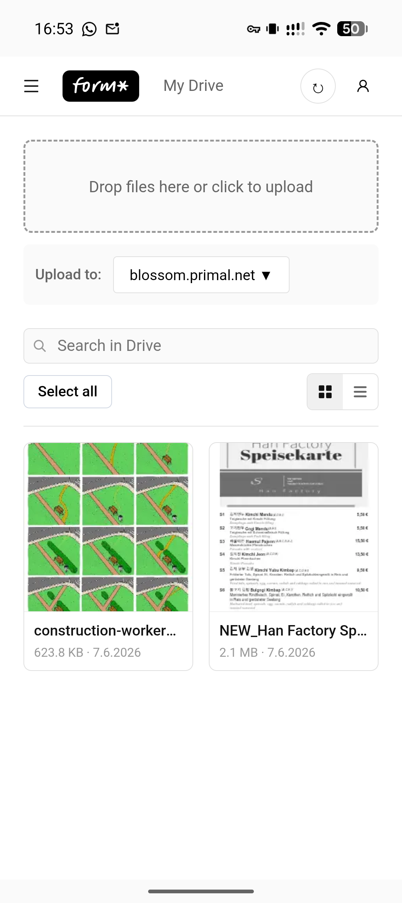

# Formstr Drive

A private, end-to-end encrypted drive powered by [Nostr](https://nostr.com) and [Blossom](https://github.com/hzrd149/blossom). Your files, your keys.

Files are encrypted in your browser (or the Android app) before they leave your device and are stored as opaque blobs on the Blossom servers you choose. The file index is stored as encrypted Nostr events on relays. Only the holder of the Nostr private key can read either.

> **Experimental.** The standards this builds on may change between releases. Use accordingly.

**Live app:** https://drive.formstr.app



## Features

- End-to-end encrypted storage: per-file keys, with metadata encrypted to your own Nostr key
- Choose your own Blossom servers, including servers discovered on Nostr
- Folders, bulk actions, rename, move and delete (deletes also remove the blob from the server via Blossom `DELETE`)
- In-app preview for images, video, PDF and text, plus an "Open in Nostr Docs" deeplink for office documents
- Chunked uploads and downloads with progress, and background transfers on Android
- Multiple accounts, with switching between them
- Sign in with a NIP-07 browser extension, or a native signer app on Android
- Android app built with Capacitor

## How it works

| Layer             | Where it lives | What it sees                           |
| ----------------- | -------------- | -------------------------------------- |
| File contents     | Blossom server | Encrypted bytes only                   |
| File index        | Nostr relays   | Encrypted events (kind 34578)          |
| Keys and identity | Your signer    | Never leaves the extension or signer   |

See [ARCHITECTURE.md](ARCHITECTURE.md) for the event formats, encryption scheme, upload and download flows, and known limitations.

## Getting started

Requirements: Node.js and [pnpm](https://pnpm.io) (npm and yarn are blocked by a `preinstall` check).

```bash
pnpm install
pnpm dev
```

Then open the URL Vite prints. To sign in you need a NIP-07 extension (for example Alby or nos2x) or a Nostr signer.

### Scripts

| Command          | What it does                                  |
| ---------------- | --------------------------------------------- |
| `pnpm dev`       | Start the Vite dev server                     |
| `pnpm build`     | Typecheck and build to `dist/`                |
| `pnpm preview`   | Serve the production build locally            |
| `pnpm typecheck` | Typecheck the app (`tsc -p tsconfig.app.json`) |
| `pnpm lint`      | Run ESLint on `src/`                          |
| `pnpm test`      | Run the Vitest suite once                     |

## Android

The Android app wraps the web build with [Capacitor](https://capacitorjs.com).

```bash
pnpm android:sync    # build the web app and sync it into android/
pnpm android:open    # open the project in Android Studio
```

`pnpm android:build-release` (see `scripts/build-android-release.sh`) builds a signed release APK; it needs a keystore configured in `android/keystore.properties`. The app is also published via [Zapstore](https://zapstore.dev) (see `zapstore.yaml`).

## Project layout

```
src/
├── auth.ts, crypto.ts, blossom.ts   # Blossom auth events, file encryption, Blossom client
├── services/                        # File index, uploads, downloads, previews, relay helpers
├── transfers/                       # Upload/download queue and drivers
├── signer/                          # Signer and account management
├── components/                      # React UI
├── native/                          # Android-specific glue
└── worker/                          # Web workers (relay, SHA-256)
```

## Contributing

Open an issue or a pull request against `main`. Before submitting, please run:

```bash
pnpm typecheck
pnpm lint
pnpm test
```

## License

[MIT](LICENSE) © Formstr Inc
